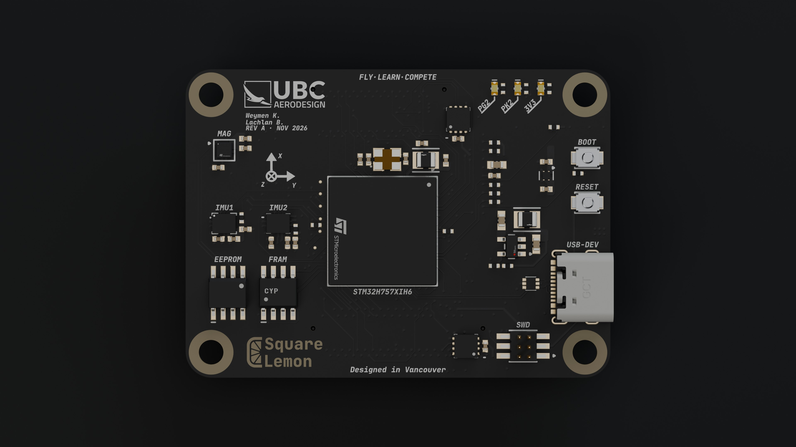
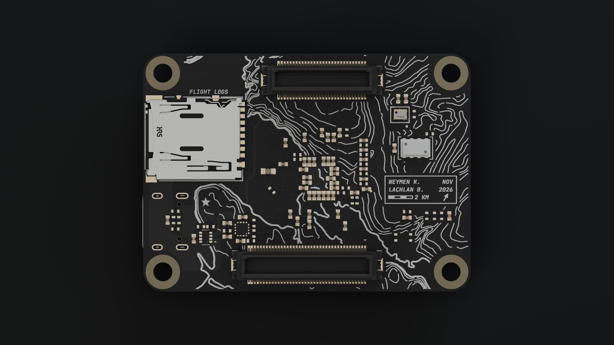

# UBC AeroDesign Flight Controller SoM

System-on-module flight controller for UBC AeroDesign, built around the STM32H757 and targeting ArduPilot. The module carries the MCU, IMUs, barometers, storage and power conversion, and connects to a carrier board and a payload board through two board-to-board connectors.


| Top | Bottom | Bottom, angled |
|---|---|---|
|  |  |  |

| | |
|---|---|
| Revision | Rev A (prototype) |
| Size | 55 × 40 mm, 8 layers |
| MCU | STM32H757XIH6, Cortex-M7 at 400 MHz |
| Firmware | ArduPilot (ChibiOS) |
| Input | 5 V from carrier or USB-C |
| Finish | Black solder mask, white silkscreen, ENIG |

## Hardware

### Processor
- STM32H757XIH6 (not the `A` suffix), TFBGA-265, 2 MB flash.
- Core supply from the internal SMPS in direct mode. Maximum clock in this mode is 400 MHz.
- 25 MHz HSE crystal.
- Cortex-M4 core unused.

### Sensors

| Function | Part | Bus |
|---|---|---|
| IMU 1 | ST LSM6DSV32X | SPI1 |
| IMU 2 | TDK ICM-42688-P | SPI5 |
| Barometer 1 | Infineon DPS368 | SPI1 |
| Barometer 2 | TE MS5611 | SPI5 |
| Magnetometer | ST LIS2MDL (optional) | I2C4, 0x1E |

Each SPI bus carries one IMU and one barometer, so a single bus failure leaves one complete IMU and barometer pair.

### Storage
- Parameters: Infineon FM25V02A, 32 KB FRAM on SPI2.
- Board ID: ST M24C64 EEPROM on I2C4, 0x50, write-protected by default.
- Logs: microSD (Hirose DM3), 4-bit SDMMC1.

### Power
- Two 5 V inputs: carrier (J4) and USB-C VBUS. TI TPS2116 priority mux; the carrier has priority.
- TI TPS259474A eFuse: 1.1 A current limit, under- and over-voltage lockout.
- TI TLV62569 buck: 3.3 V main rail.
- TI TPS7A20 LDO: separate 3.3 V rail for the sensors.

### Interfaces

| Ref | Connector | Side | Function |
|---|---|---|---|
| J4 | Hirose DF17, 80-pin | Bottom | Carrier: power, PWM, serial, I2C, CAN, ADC, GPIO |
| J5 | Hirose DF17, 60-pin | Bottom | Payload: SPI6, UART, I2C, CAN2, GPIO, power |
| J2 | USB-C (USB 2.0 FS) | Top | MAVLink, DFU, power |
| J3 | 2 × 3, 1.27 mm header | Top | SWD (custom pinout) |
| J1 | microSD | Bottom | Logging |

Mounting: 4 × M3 holes (3.2 mm, non-plated) on a 48.4 × 33.4 mm pattern.

I/O available through J4 and J5:
- 16 PWM outputs on TIM4, TIM1, TIM8 and TIM5. CH1–4 support DShot; bidirectional DShot on CH1 and CH3.
- 8 UARTs plus USB: telemetry (with RTS/CTS), companion, GPS 1, GPS 2, ELRS/CRSF, ESC telemetry (RX only), payload, debug.
- 4 I2C buses: internal (magnetometer, EEPROM), GNSS, airspeed/power monitor, payload. Pull-ups are on the module.
- 2 CAN buses with TI TCAN3414 transceivers on the module. Termination is on the carrier.
- 5 ADC inputs with RC filters on the module. Voltage dividers are on the carrier.
- SBUS input, safety switch and LED, buzzer, arming output, 6 GPIO.

## Firmware

ArduPilot board definition files (`hwdef.dat`, `hwdef-bl.dat`) are drafted and pass `chibios_hwdef.py`. They have not yet been compiled or run on hardware.

- Board ID `AP_HW_UBC_FCSOM` is a placeholder until allocated in `Tools/AP_Bootloader/board_types.txt`.
- `define SMPS_PWR` is required. A build without it misconfigures the core supply.
- Board forward is the top edge (J5 side), marked by the X arrow on the top silkscreen.
- IMU rotation from datasheet and footprint orientation: `ROTATION_ROLL_180_YAW_90` for both IMUs. Confirm by motion test.
- The LSM6DSV32X must have I2C disabled (`IF_CFG`) before any other traffic on SPI1.

## Manufacturing

- Fabrication and assembly: JLCPCB, both sides populated.
- 8 layers: SIG / GND / SIG / PWR / GND / SIG / GND / SIG.
- Vias in pads: order epoxy-filled and capped vias.
- The board is below JLCPCB's assembly minimum size; panelise or add edge rails.
- Outputs (Gerber RS-274X, Excellon drill, pick-and-place, BOM, STEP) are generated by the Altium OutJob into `Project Outputs for Flight Controller SoM/`.

## Repository layout

```
Flight Controller SoM.PrjPcb             Altium project
Project Outputs for Flight Controller SoM/
  Fabrication/                           Gerbers and drill files
  Assembly/                              Pick-and-place and BOM
  Mechanical/                            STEP model
  Documentation/                         Schematic PDF
firmware/hwdef/                          ArduPilot hwdef.dat and hwdef-bl.dat
docs/images/                             Renders
```

## Status

Rev A is in pre-order review. Not yet fabricated or tested.

Open before ordering:
- Power-path BOM changes: R20 33.2 kΩ, R27 110 kΩ (OVLO 5.46 V), R18 249 kΩ (mux threshold).
- Supplier part numbers for all BOM lines.
- Plane clearance to the 0.65 mm peg holes (increase to 0.25 mm).
- Regenerate the schematic PDF.

## Authors

Weymen Koo, Lachlan Biersteker — UBC AeroDesign, Vancouver, 2026.

## License

TBD.
