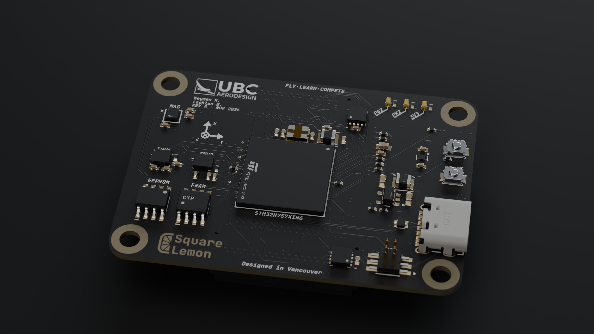
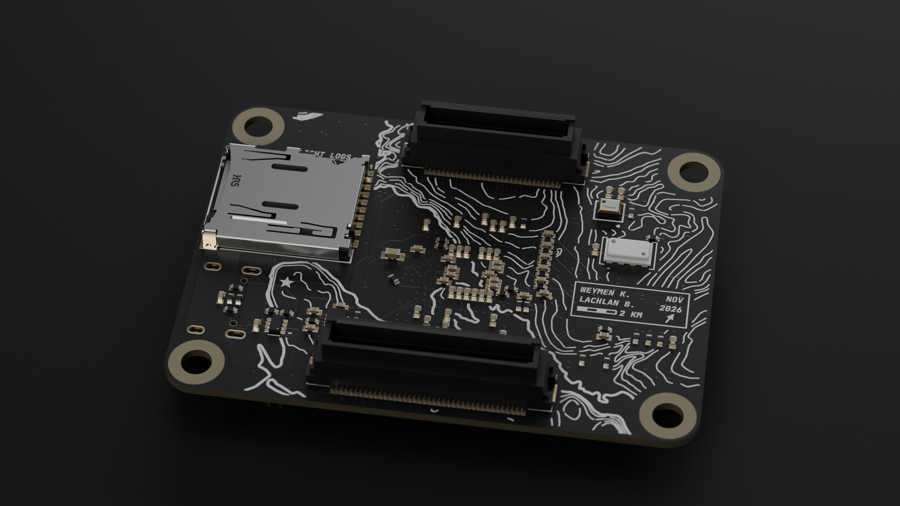
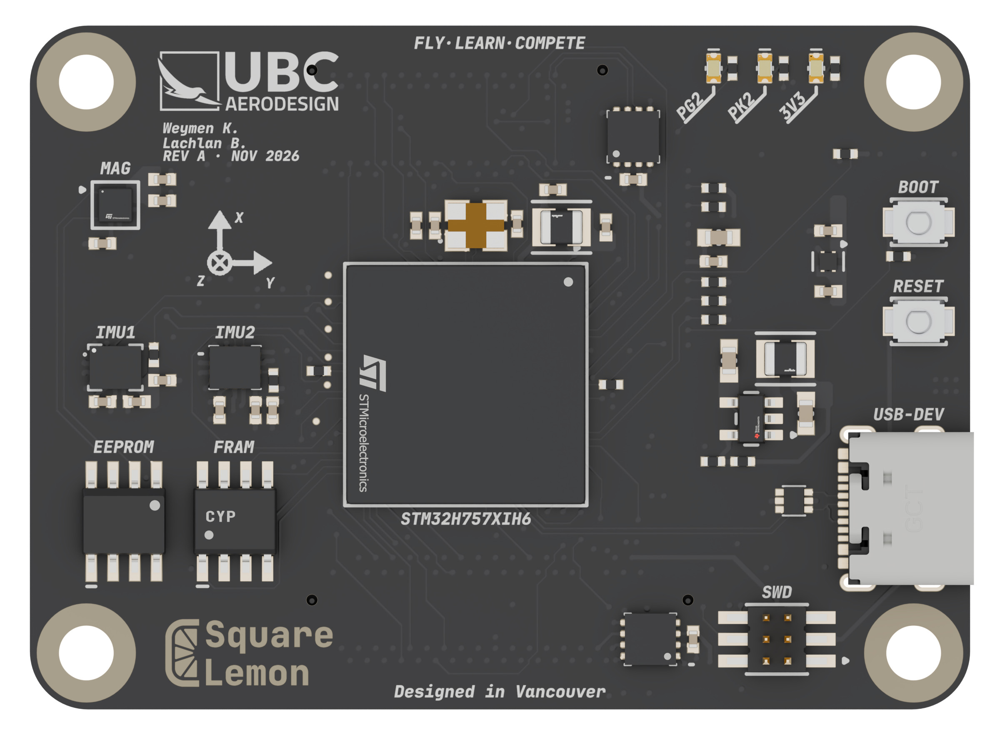
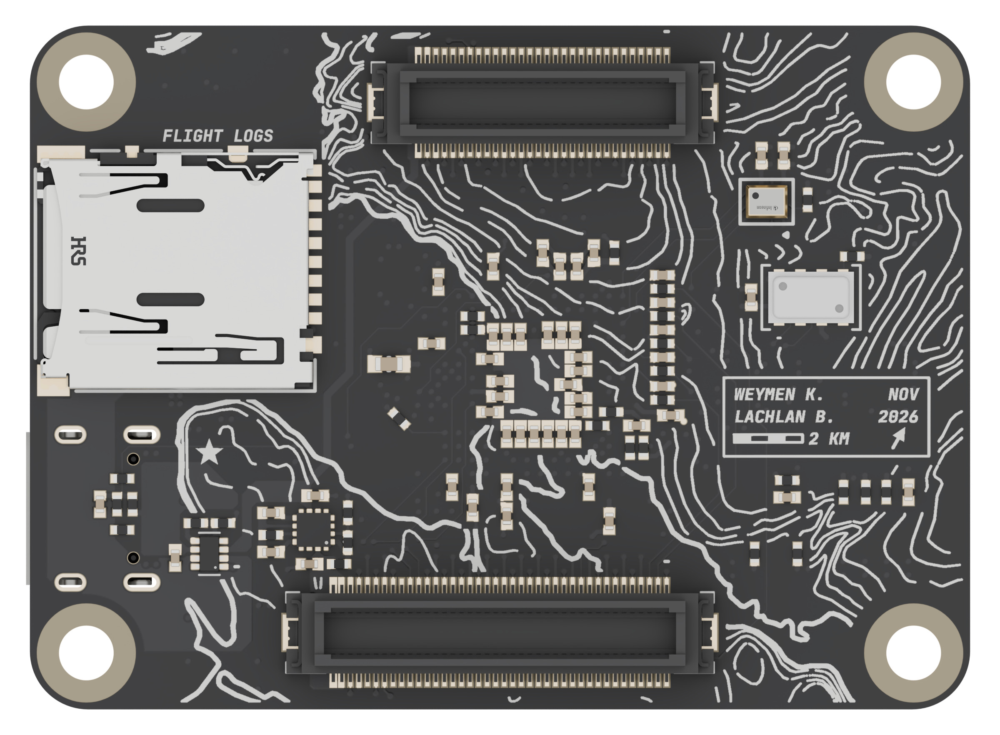
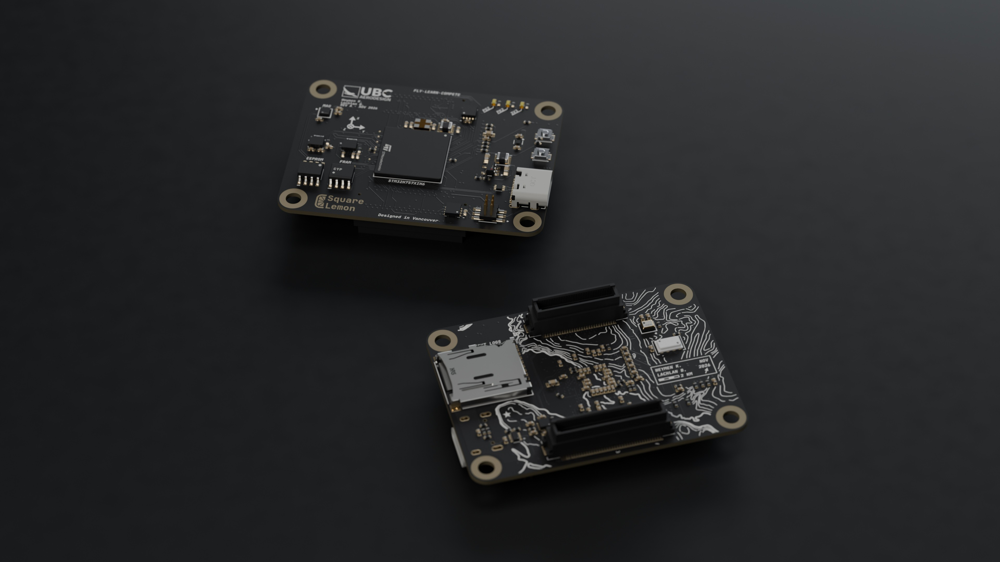

# UBC AeroDesign Flight Controller SoM

A flight-controller system-on-module for UBC AeroDesign, built around the STM32H757 and running ArduPilot. The 55 × 40 mm, 8-layer module carries the MCU, two IMUs, two barometers, a magnetometer, FRAM, microSD and the power path. It plugs into a carrier board and a payload board through two Hirose DF17 board-to-board connectors.

<p align="center">
  
</p>

<p align="center">
  <b><a href="FC_SoM_RevA_Schematic.pdf">Schematic (PDF)</a></b> &nbsp;·&nbsp;
  <b><a href="jlcpcb/">JLCPCB files</a></b> &nbsp;·&nbsp;
  <b><a href="mechanical/FC_SoM_RevA.step">STEP model</a></b> &nbsp;·&nbsp;
  <b><a href="altium/">Altium project</a></b>
</p>

<p align="center">
  
</p>

## At a glance

| | |
|---|---|
| Revision | Rev A |
| Board | 55 × 40 mm, 8 layers, ENIG, black mask, white silkscreen |
| Processor | STM32H757XIH6, Cortex-M7 at 400 MHz, 2 MB flash |
| Firmware | ArduPilot (ChibiOS) |
| Sensors | 2 IMUs, 2 barometers, magnetometer |
| Storage | 32 KB FRAM (parameters), microSD (logs), 8 KB EEPROM (board ID) |
| Power | 5 V from the carrier or USB-C, eFuse with a 1.1 A limit |
| I/O | 16 PWM, 8 UARTs + USB, 4 I2C, 2 CAN, 5 ADC |
| Assembly | 150 parts (59 top, 91 bottom), 22 test pads |

## Board views

<p align="center">
  
</p>

<p align="center">
  
</p>

<p align="center">
  
</p>

More renders are in [`renders/`](renders/).

## Hardware

### Processor
- STM32H757XIH6 (not the `A` suffix), TFBGA-265.
- Core supply from the internal SMPS in direct mode, so the maximum clock is 400 MHz.
- 25 MHz HSE crystal. The Cortex-M4 core is unused.

### Sensors

| Function | Part | Bus |
|---|---|---|
| IMU 1 | ST LSM6DSV32X | SPI1 |
| IMU 2 | TDK ICM-42688-P | SPI5 |
| Barometer 1 | Infineon DPS368 | SPI1 |
| Barometer 2 | TE MS5611 | SPI5 |
| Magnetometer | ST LIS2MDL (optional) | I2C4, 0x1E |

Each SPI bus carries one IMU and one barometer, so a single bus failure leaves a complete IMU and barometer pair.

### Storage
- Parameters: Infineon FM25V02A, 32 KB FRAM on SPI2.
- Logs: microSD (Hirose DM3), 4-bit SDMMC1.
- Board ID: ST M24C64 EEPROM on I2C4, 0x50, write-protected by default. ArduPilot has no driver for it.

### Power
- Two 5 V inputs, carrier (J4) and USB-C VBUS, through a TI TPS2116 priority mux. The carrier has priority.
- TI TPS259474A eFuse with a 1.1 A current limit. The carrier input is accepted from 4.19 V (rising, drops out at 3.81 V) up to 5.46 V.
- TI TLV62569 buck for the 3.3 V main rail, TI TPS7A20 LDO for a separate 3.3 V sensor rail.

### Interfaces

| Ref | Connector | Side | Function |
|---|---|---|---|
| J4 | Hirose DF17, 80-pin | Bottom | Carrier: power, PWM, serial, I2C, CAN, ADC, GPIO |
| J5 | Hirose DF17, 60-pin | Bottom | Payload: SPI6, UART, I2C, CAN2, GPIO, power |
| J2 | USB-C (USB 2.0 FS) | Top | MAVLink, DFU, power |
| J3 | 2 × 3, 1.27 mm header | Top | SWD (custom pinout) |
| J1 | microSD | Bottom | Logging |

Mounting: 4 × M3 holes (3.2 mm, non-plated) on a 48.4 × 33.4 mm pattern.

I/O available through J4 and J5:
- 16 PWM outputs on TIM4, TIM1, TIM8 and TIM5. CH1–4 support DShot; bidirectional DShot on CH1 and CH3.
- 8 UARTs plus USB: telemetry (with RTS/CTS), companion, GPS 1, GPS 2, ELRS/CRSF, ESC telemetry (RX only), payload, debug.
- 4 I2C buses: internal (magnetometer, EEPROM), GNSS, airspeed/power monitor, payload. Pull-ups are on the module.
- 2 CAN buses with TI TCAN3414 transceivers on the module. Termination is on the carrier.
- 5 ADC inputs with RC filters on the module. Voltage dividers are on the carrier.
- SBUS input, safety switch and LED, buzzer, arming output, 6 GPIO.

### Test points
22 pads (0.8 mm, top side): VBUS, +VCARRIER, +5V_EFUSE, +VMUX, +3V3LDO, +A3V3, 6 × GND, debug UART, SPI1, internal I2C, both IMU interrupts, DBG2 and PAY_IO17.

## Firmware

ArduPilot board definition files (`hwdef.dat`, `hwdef-bl.dat`) are drafted and pass `chibios_hwdef.py`. They are not in this repo yet and have not been compiled or run on hardware.

- `define SMPS_PWR` is required. A build without it misconfigures the core supply.
- Board ID `AP_HW_UBC_FCSOM` is a placeholder until allocated in `Tools/AP_Bootloader/board_types.txt`.
- Board forward is the top edge (J5 side), marked by the X arrow on the top silkscreen.
- IMU rotation from the datasheets and footprints: `ROTATION_ROLL_180_YAW_90` for both IMUs. Confirm with a motion test.
- The LSM6DSV32X must have I2C disabled (`IF_CFG`) before any other traffic on SPI1.

## Manufacturing (JLCPCB)

These files were exported on 15 Nov 2026 from the final board and checked against the PCB file. Every pad, track and via in the PCB is in the Gerbers, and the BOM and CPL list the same 150 parts.

| File | Upload as |
|---|---|
| [`jlcpcb/FC_SoM_RevA_Gerbers.zip`](jlcpcb/FC_SoM_RevA_Gerbers.zip) | Gerber files (15 Gerber layers and 3 Excellon drill files) |
| [`jlcpcb/FC_SoM_RevA_BOM_JLCPCB.csv`](jlcpcb/FC_SoM_RevA_BOM_JLCPCB.csv) | BOM |
| [`jlcpcb/FC_SoM_RevA_CPL_JLCPCB.csv`](jlcpcb/FC_SoM_RevA_CPL_JLCPCB.csv) | CPL (pick and place) |

| Order setting | Value |
|---|---|
| Layers | 8 |
| Layer sequence | L1 `.GTL`, L2 `.G1`, L3 `.G2`, L4 `.G3`, L5 `.G4`, L6 `.G5`, L7 `.G6`, L8 `.GBL` (files are already in stack order) |
| Stack-up | Any JLCPCB 8-layer stack-up. No impedance control is needed (USB full speed only). The stack in the Altium file is not one JLCPCB builds. |
| Thickness | 1.6 mm (JLCPCB default) |
| Surface finish | ENIG |
| Via covering | Epoxy filled and capped. About 200 vias sit in pads; free on 6+ layer boards. |
| Mask / silkscreen | Black / white |
| Assembly | Standard PCBA, both sides. The board is under 70 × 70 mm, so JLCPCB adds 5 mm edge rails. |
| Inspection | X-ray for the BGA |

After uploading the BOM, 22 lines have no LCSC number: ICs, connectors, inductors, switches, R18 and R27. Their Comment column holds the exact manufacturer part number, so match them in JLCPCB's BOM tool. Then check every rotation in the placement preview, particularly U1, J1, J2, J4 and J5.

### Re-exporting from Altium
1. Open `altium/Flight Controller SoM.PrjPcb` and run `FC_SoM_Release.OutJob`. Altium writes into a `Project Outputs for Flight Controller SoM/` folder, which git ignores.
2. Zip the 15 Gerber files and the 3 drill `.TXT` files into `jlcpcb/FC_SoM_RevA_Gerbers.zip`. Copy the schematic PDF to the repo root and the STEP model to `mechanical/FC_SoM_RevA.step`.
3. If a part moved, rebuild the CPL from Altium's pick-and-place with the columns Designator, Mid X, Mid Y, Layer (Top/Bottom) and Rotation. Leave the test pads (TP1–TP22) out; they are not assembled.
4. Altium's own BOM export merges different values into one line per footprint, so it can't be uploaded. Keep `jlcpcb/FC_SoM_RevA_BOM_JLCPCB.csv` in sync by hand.

## Repository layout

```
FC_SoM_RevA_Schematic.pdf   Schematic (18 sheets) and PCB layer prints, 23 pages
jlcpcb/                     Gerber and drill zip, BOM, CPL: the JLCPCB upload set
mechanical/                 STEP model of the assembled board
altium/                     Altium Designer project: schematic sheets, PCB, ActiveBOM, OutJob
renders/                    Product renders
```

## Status

Rev A. Design complete. Altium DRC clean (0 violations, 14 Nov 2026); the only later edits were part parameters, net colours and silkscreen. Manufacturing files exported 15 Nov 2026. Not yet fabricated or tested.

## Authors

Weymen Koo, Lachlan Biersteker — UBC AeroDesign, Vancouver, 2026.

## License

TBD.
