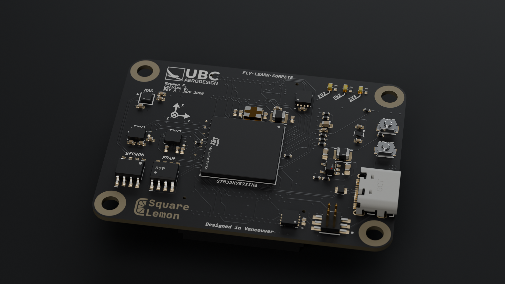
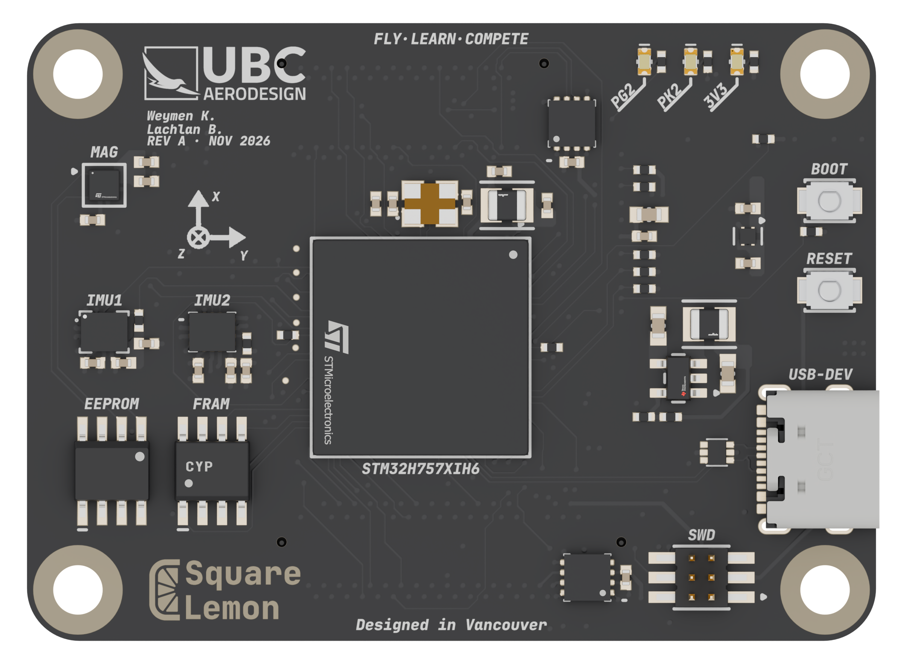
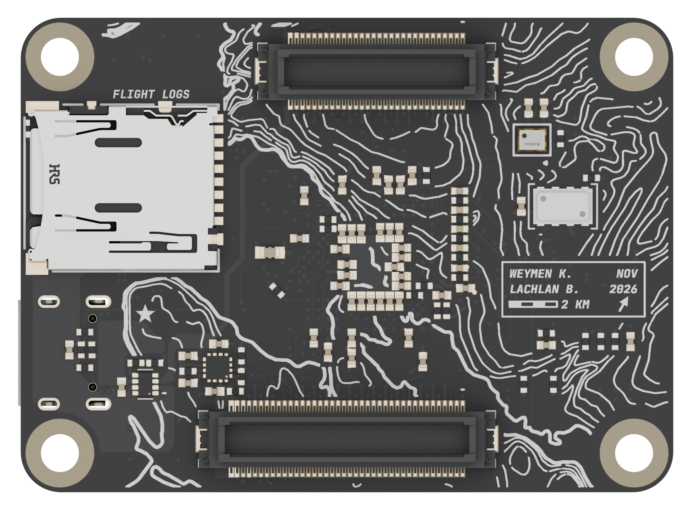

# Flight Controller SoM

A small flight controller for autonomous aircraft. It's the "brain" that reads the sensors, keeps the aircraft stable, follows a flight plan and controls the motors and servos.

It runs [ArduPilot](https://ardupilot.org/), the open-source autopilot, on an STM32H7 processor. The whole thing is a 55 x 40 mm module (SoM, system-on-module) that plugs into a carrier board. The carrier handles wiring to the rest of the aircraft, so the same flight controller can go into different airframes.

## What it does

- **Senses motion and altitude** with two IMUs (accelerometer and gyroscope) and two barometers. Each sensor has a backup from a different maker, so one failure doesn't bring the aircraft down.
- **Controls the aircraft** through 16 motor and servo outputs.
- **Talks to everything else** on board over GPS, radio receiver, telemetry, CAN and I2C links.
- **Logs every flight** to a microSD card.
- **Runs a separate payload** (cameras, drop mechanisms and the like) through its own connector, kept apart from the flight-critical signals.
- **Connects to a computer over USB-C** for setup, firmware updates and log download.

| Top | Bottom |
|---|---|
|  |  |

Designed in Altium by UBC AeroDesign, 2026.
